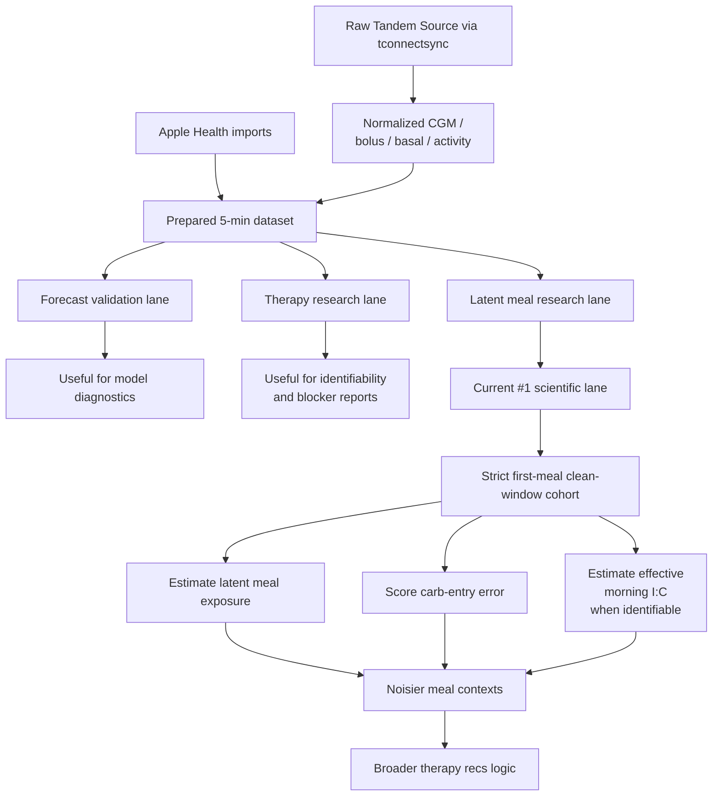

# Technical Lab Notebook: Bayesian T1DM

**Updated**: November 17, 2026  
**Branch**: `main`  
**Project**: Bayesian T1DM (`bayesian-t1dm`)  
**Purpose**: Technical status notebook for the checked-in `main` branch

## Scope Note

This notebook describes what the repository is actually trying to do right now and what the current branch really implements.

It is not a product roadmap, and it is not a promise that every checked-in workflow is equally important.

The point of this file is to reduce scatter by separating:

- active scientific priorities
- useful but secondary infrastructure
- experimental side tracks
- deferred ideas that should not drive day-to-day work yet

## Executive Summary

The repository is best understood as a **personal diabetes research workbench**, not a finished therapy-recommendation product.

The strongest current conclusion is not a therapy setting recommendation. It is a data-truth conclusion:

- the Tandem archive **does** contain carbohydrate records: carbs typed into the bolus calculator are on the pump's `LID_BOLUS_REQUESTED_MSG1` event, together with the carb ratio in force; `LID_BOLUS_REQUESTED_MSG2` holds the correction factor and target in force. Counts are in `data/merged/validation_report.md`
- the canonical Tandem feature table therefore has `carb_grams == 0` and `meal_event == 0` everywhere unless meal information is supplied from some other source
- this makes direct recovery of basal, I/C, and sensitivity from observed glucose much harder than the repo originally hoped

That does **not** mean the project is blocked completely.

The current best scientific path is:

1. stop pretending meal truth is directly observed
2. treat meal response as a partially observed latent-signal problem
3. start with **strict, low-confounding first-meal windows**
4. estimate **latent meal exposure** and **carb-entry error** before trying to make broad therapy claims

## November 2026 Audit: What Actually Works

This section records a code and method audit done without access to the personal dataset. Everything below was established by reading the code, running the test suite, and simulating data with known truth. Nothing here is a finding about real glucose data.

### Verified

- The test suite passes (ingestion, Apple Health import, feature construction, model plumbing, report and status writers, CLI commands) and now runs in CI on Python 3.11 and 3.13.
- The trajectory-based latent carb estimator recovers simulated carbohydrate. Against meals bolused for a mis-counted amount, bolus x I:C is off by about 17 g on average; the trajectory estimator is off by 2.5 to 9 g in seven of eight scenarios with 90% intervals that cover truth at least 90% of the time, including a scenario where absorption shape, bolus timing, therapy settings and drift are all wrong together. Reproduce with `bayesian-t1dm validate-latent-meal`.

- The real commands run end to end on a raw tree laid out like the Tandem archive but filled with simulated days: `build-dataset`, `research-latent-meal-icr --research-scope full` (which picked up a hand-kept `carbs.csv` and reported an effective I:C of 7.8 [7.4, 8.2] against a simulated truth of 8.0), and `run --skip-recommendations` (model MAE 2.8 against persistence 5.9 mg/dL, 80% interval coverage 0.75). The first two are now an automated test.

### Found broken and fixed

1. **Look-ahead leak in the forecast features.** CGM gaps were filled by linear interpolation, so a row inside a gap was given a glucose value computed from the reading at the far end of the gap, frequently the very value it was asked to forecast. Both the model and the persistence baseline benefited. The fill is now last-observation-carried-forward. Any walk-forward MAE or coverage number produced before this fix was optimistic by an unknown amount and should be regenerated.
2. **The original latent carb estimator was miscalibrated.** The peak/AUC grid posterior was biased about +12 g in simulation and its 90% intervals covered truth 55 to 72% of the time. It is now only a fallback.
3. **"Posterior probability better" was not a probability.** It was the share of forecast timepoints at which the mean prediction was closer to target, which reads 1.0 for any uniform shift. It is now the share of paired posterior draws in which the scenario wins.
4. **Meal-window CGM coverage was overstated.** Coverage was computed over the rows present, but a CGM gap removes rows from the prepared frame. Windows with holes could pass the 90% gate. Coverage is now measured against the rows a complete window should have.
5. **`max_treedepth` was not reaching the sampler** on PyMC 5 (and the spelling used is deprecated on PyMC 6).
6. **A hand-kept carb log was silently ignored** unless it sat in a directory named `normalized`. `carbs.csv` or `carb_log.csv` with `timestamp,carb_grams` is now read from anywhere in the raw tree, and a logged entry no longer has to fall in the same 5-minute bin as the bolus.

7. **Pump-entered carbs were thrown away.** Only `LID_BOLUS_DELIVERY` events were kept; the carb amount lives on `LID_BOLUS_REQUESTED_MSG1`, linked by bolus id. Collection now emits a `carbs` payload family (carbs kept only when that bolus was actually delivered), and `normalize-raw` decodes the already-archived `pump_events_raw_*.txt` files for windows collected before the fix.
8. **Collection would not run on a fresh install.** `tconnectsync` was unpinned; 3.0 removed `pump_event_metadata()` and `pump_events_raw()`, which collection calls. It is now pinned to `>=2.2,<3`, and the test suite passes on 2.3.4.

### Data pipeline

```bash
bayesian-t1dm backfill --start-date YYYY-MM-DD --end-date YYYY-MM-DD   # Tandem Source via tconnectsync 3.x
bayesian-t1dm build-dataset                                             # merge, deduplicate, validate (only when raw changed)
bayesian-t1dm research-latent-meal-icr --research-scope full
```

- Tandem Source retired the endpoints tconnectsync 2.x used in mid-2026 (they now return HTTP 403); collection uses 3.x (`get_pumper`, `get_pump_logs`). Windows collected with 2.x keep their base64 event files, which 3.x still decodes.
- Carbs are always rebuilt from a window's raw pump events, with the I:C ratio and correction factor the bolus calculator used. Each breakfast is compared with the setting in force for it, and the effective I:C is reported per settings period; the current period is the headline.
- `data/raw/context_events.csv` lists date ranges left out of the meal and overnight-basal analyses (for example the 14 days after a steroid injection). Excluded first meals are a hard exclusion in every analysis tier.
- An unreadable archived event file is an error, not a silent skip.

### Structural limits that no code change removes

- **Carbs and I:C are not separately identifiable from glucose.** A post-meal trace identifies `carbs x CF / ICR`. Without carbohydrate truth (pump-entered carbs, if they turn out to exist, are exactly that truth), "the meal was undercounted" and "the I:C ratio is too weak" produce the same trace. The honest per-meal output is a carb-equivalent under the programmed settings, or equivalently a statement about whether the bolus was adequate for that meal. Phase D ("carb-entry error scoring") and "effective I:C" are the same number viewed two ways until some meals have trusted carb counts.
- **What breaks the tie:** a few weeks of deliberately weighed or packaged breakfasts logged with carbs. This path is now implemented: put a `carbs.csv` (`timestamp,carb_grams`) in the raw data tree and the full latent-meal run reports an effective I:C per segment with a 90% interval once at least 5 clean logged meals exist. In simulation, 20 logged meals recover a true ratio of 8 or 12.5 against a programmed 10 to within about 3%, and flag the difference every time. This is the shortest route from this repo to an actual statement about a therapy setting.
- **Late absorption is invisible.** Carbohydrate that lands after the 180-minute window biases the estimate low (about -18 g in the biphasic simulation). Fat- and protein-heavy meals should not be trusted.
- **Closed-loop basal is only approximately accounted for.** Control-IQ raises and lowers basal during the post-meal window. The estimator counts delivery above or below a schedule inferred from the median delivery at that time of day, which is right when modulation varies from day to day and wrong when the controller does the same thing most mornings. The size of the residual error on real data is unknown.

### Status of the real-data runs

Real-data results come from generated reports that trace to a run, not from this notebook: `data/merged/validation_report.md` (what went into the dataset), `output/latent_meal/latent_meal_review.html` (breakfast I:C), `output/forecast/forecast_review.html` (forecast against the "glucose stays the same" baseline).

Open items:

1. CGM readings are placed at the sensor's measurement time (`egvTimeStamp`), not the pump's receipt time. Readings backfilled after a signal dropout used to arrive together and pile into one 5-minute slot, leaving the slots before them empty; that was why every window showed repeated timestamps and short gaps. A window now counts as incomplete only when its download misses requested days or a required data type; CGM coverage and gaps of 2 hours or more are reported per window as data quality.
2. The forecast model is a regression of glucose 30 minutes ahead on current and lagged glucose, insulin, carbs, basal and time of day. Its value over the baseline on real data has to be read from the forecast page of a current run.

### Lane status

| lane | status |
| --- | --- |
| Acquisition, normalization, Apple Health import | Tested; not re-run on real data in this audit |
| Prepared 5-minute dataset | Tested; gap fill is now causal |
| Forecast validation | Plumbing tested; earlier real-data metrics are suspect because of the leak |
| Forecast-based recommendations | Always suppressed on real data (no carbs). The scenario math is a sensitivity analysis of a predictive regression, not a causal estimate. Lowest priority |
| Therapy research (basal / I:C identifiability) | Tested on synthetic frames where the 30-minute target is a linear function of the features but the glucose series itself has no meal or insulin dynamics, so its "truth recovery" is weaker evidence than the name suggests |
| Latent meal | Phase B (cohort) and Phase C (estimator) are implemented and validated in simulation. Effective I:C from logged meals is implemented and validated in simulation. Real-data fit quality unknown; no carb log exists yet |

## Current North Star

The near-term scientific question is:

**Can we identify useful meal-response information from the data we actually have, even when explicit carb truth is absent?**

More concretely:

- can we identify a subset of meals where latent carb exposure is estimable with useful uncertainty bounds?
- can we score whether an entered or implied carb amount was probably undercalled, overcalled, or roughly consistent with the observed response?
- can we learn a context-specific effective I/C signal for those high-quality windows only?

This is a better near-term target than trying to infer all therapy settings globally from all rows.

## Current Branch Reality

The checked-in branch has several real subsystems:

1. **Acquisition and normalization**
   - `tconnectsync` Tandem Source pulls
   - raw payload archival
   - normalized CGM / bolus / basal / activity tables
   - Apple Health import and overlap-aware dedupe

2. **Prepared analysis dataset**
   - Tandem-aligned 5-minute grid
   - insulin action and IOB expansion
   - Apple Health context alignment
   - rolling, lagged, and calendar features

3. **Forecast validation lane**
   - walk-forward glucose forecasting
   - baseline comparison
   - run summary and review artifacts

4. **Therapy research lane**
   - segment-level basal / I:C identifiability review
   - source report cards
   - model comparison and recommendation suppression

5. **Latent meal research lane**
   - meal event registry
   - meal-window extraction
   - latent carb / effective I:C approximation
   - confidence and identifiability reporting

These are all real code paths, but they should not all be treated as equal strategic priorities.

## What We Know Right Now

### 1. The Tandem raw archive is not giving us explicit carb truth

Current archived `tconnectsync` raw payload families are:

- `activity`
- `basal`
- `bolus`
- `cgm`
- `pump_event_metadata`

The sampled `bolus.json` records currently expose only insulin amount, timestamp, and source-event metadata, not explicit carbohydrate values.

Operational implication:

- explicit Tandem carb truth is currently unavailable in the canonical raw source

### 2. The prepared Tandem feature table reflects that absence

In the current runtime outputs, the Tandem source report card shows:

- `carb_grams` all zero
- `meal_event` all zero
- `minutes_since_last_meal` all zero

Operational implication:

- the base feature frame should not be interpreted as containing observed meal truth

### 3. Some Health-derived context features were malformed and needed repair

Known fixes already landed:

- workout recency/count windows were repaired
- plausibility guards were added for workout summaries
- sparse physiology such as HRV and resting heart rate now carries freshness metadata instead of only silent zero-fill semantics

Operational implication:

- Apple context is still useful, but it must be handled as partially missing and quality-gated

### 4. The repo has been mixing several goals at once

The codebase currently mixes:

- forecasting
- therapy recommendation support
- feature engineering diagnostics
- source auditing
- latent meal inference

Operational implication:

- without a lab-notebook-style priority structure, the project feels more advanced than it actually is

## Working Scientific Frame

The most useful framing right now is:

**Observed glucose is a mixed response signal generated by latent meal exposure, insulin delivery, basal state, closed-loop behavior, exercise/recovery, sleep, stress, and measurement gaps.**

This means:

- we should stop thinking in terms of “recover the true carbs directly from the table”
- we should instead think in terms of **latent meal-response deconvolution under uncertainty**

The ABSOLUTE analogy is still helpful at the level of mindset:

- infer hidden contributors from indirect noisy observations
- quantify uncertainty
- separate what is observed from what is inferred

The analogy breaks if we pretend glucose is a static mixture problem. It is a dynamic feedback-controlled system.

So the active model worldview should be:

- **hierarchical meal-response estimation**
- **strict identifiability gating**
- **honest suppression when the window is too confounded**

## Active Research Priority

The repo should focus on one primary research lane for now:

### Priority 1: Clean First-Meal Meal-Response Windows

Initial target cohort:

- first meal or first meal-like bolus of the day
- long fasting interval beforehand
- premeal BG in or near target
- low premeal IOB
- little evidence of recent correction activity
- little evidence of recent workout carryover
- high enough CGM coverage through the post-meal horizon

Primary estimands for this phase:

- latent meal exposure
- carb-entry consistency or error score
- morning first-meal effective I/C, only when identifiable

Why this comes first:

- it is the least confounded setting available in the current data
- it gives the best chance of learning whether the latent-meal program is scientifically useful
- it can later serve as training or calibration data for messier meal windows

## Explicitly Deferred For Now

These are not abandoned forever, but they should not be allowed to drive the repo in the next phase:

- global basal optimization as the main headline
- sensitivity-factor inference as a primary target
- generalized therapy recommendations across all meal contexts
- claiming exact meal carb truth for every bolus
- broad productization of the dashboards as if they are already decision-ready

## How The Pieces Fit Together



## Directional Map

The practical interpretation of the diagram is:

- the forecasting lane stays alive because it catches model-quality failures
- the therapy research lane stays alive because it reports blockers honestly
- the latent meal lane becomes the main scientific workstream
- all broader recommendation logic is downstream of whether the clean-window latent meal program succeeds

## Immediate Work Program

### Phase A: Truthful data semantics

Goals:

- stop letting missing meal truth masquerade as observed zeros
- mark explicit carb truth as missing or unavailable where appropriate
- keep source-quality metadata visible in reports

Definition of done:

- the base dataset no longer suggests that all-zero meal features are trustworthy meal observations

### Phase B: Strict first-meal cohort builder

Goals:

- define and materialize a very conservative morning clean-window cohort
- record inclusion and exclusion reasons
- quantify how many usable windows actually exist

Definition of done:

- one artifact that tells us exactly how many high-quality first-meal windows are available and why others were rejected

### Phase C: Latent meal exposure model for clean windows

Goals:

- estimate latent meal exposure from bolus plus glucose response
- use programmed I/C as a prior, not truth
- output uncertainty and identifiability status

Definition of done:

- meal-level outputs are interpretable as research estimates rather than ad hoc heuristics

Status (November 2026): implemented as the trajectory estimator and validated against simulated truth. Done in simulation, open on real data; the acceptance check is the fit RMSE and prior contraction reported by a real run.

### Phase D: Carb-entry error scoring

Goals:

- classify likely undercount / overcount / roughly consistent meal entries when any meal entries exist
- produce a score that remains useful even when exact truth is unknowable

Definition of done:

- the repo can say something more useful than “carbs are missing” for at least a subset of meal windows

Status (November 2026): blocked on data, not on code. See "Structural limits" above: without some meals carrying trusted carb counts, a carb-entry error score and an I:C error are the same quantity. The effective I:C estimator for logged meals is implemented and waiting for a carb log.

### Phase E: Expansion to less clean windows

Goals:

- test whether a clean-window-trained or clean-window-calibrated model transfers to less ideal meals
- preserve more aggressive uncertainty and suppression in these noisier settings

Definition of done:

- evidence that the clean-window program generalizes at least somewhat without pretending the noisy meals are equally identifiable

## Decision Rules For New Work

When adding or changing anything in this repo, the first question should be:

**Does this help the clean-window latent meal program, or is it a side quest?**

If it is a side quest, it should usually wait.

Concrete triage rules:

- work that improves source truth, missingness semantics, or meal-window quality is high priority
- work that improves latent meal identifiability is high priority
- work that only makes dashboards prettier is low priority
- work that assumes recommendations are already trustworthy is premature
- work that broadens scope without improving identifiability should usually be deferred

## Repo Orientation

Use the repo like this:

- `README.md` for onboarding and command entrypoints
- `docs/technical.md` for lower-level implementation and data-flow notes
- `docs/TECHNICAL_LAB_NOTEBOOK.md` for scientific direction, branch truth, and active priorities

This notebook should be updated whenever one of these changes:

- the active scientific question
- the highest-confidence data-truth conclusion
- the primary research lane
- the set of explicitly deferred goals

## Current One-Sentence Summary

This repo is currently a **research-first meal-response inference workbench** whose next serious job is to learn what can be identified from strict, low-confounding first-meal windows when explicit Tandem carb truth is absent.
